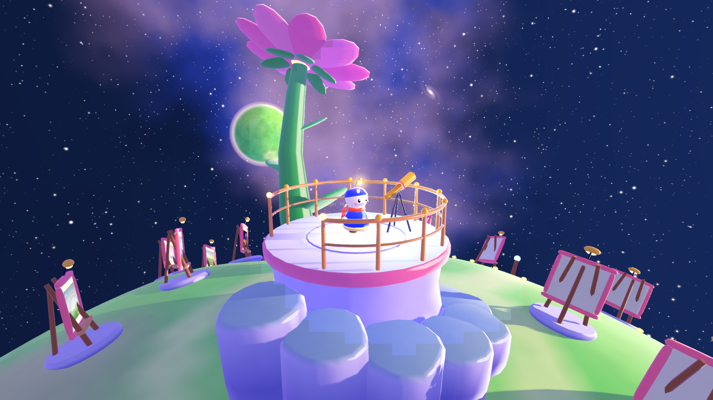
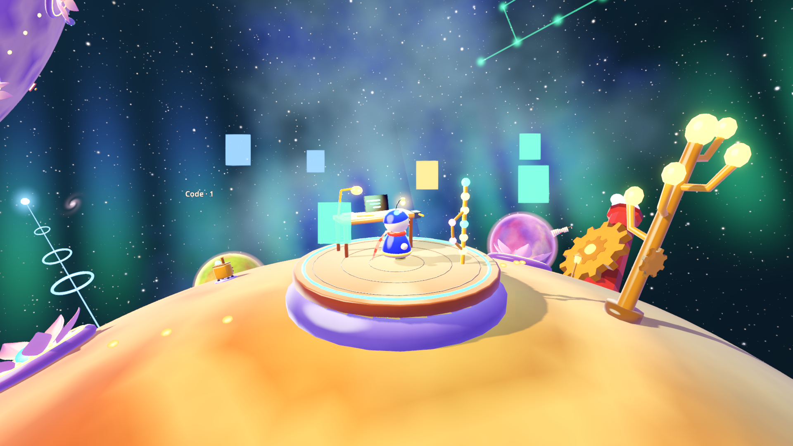
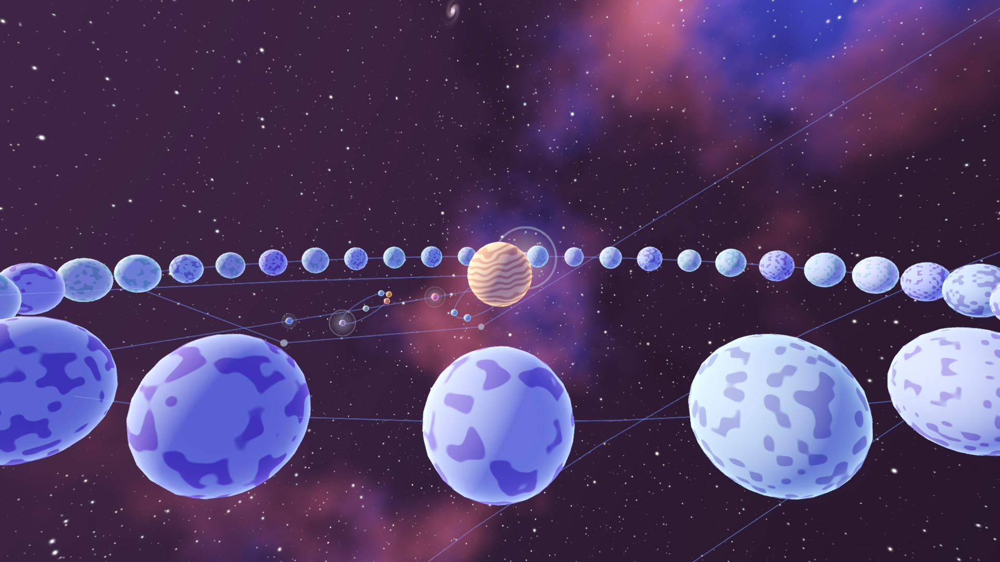
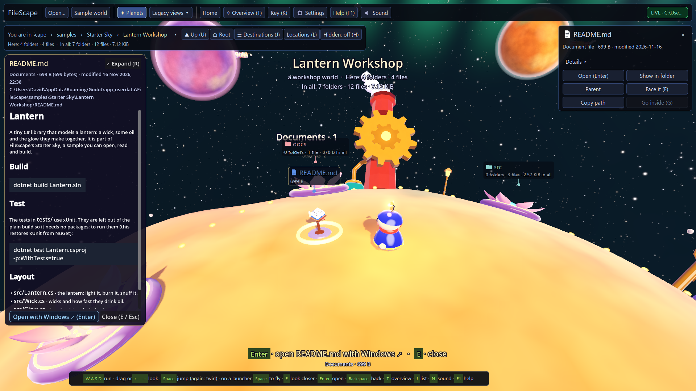
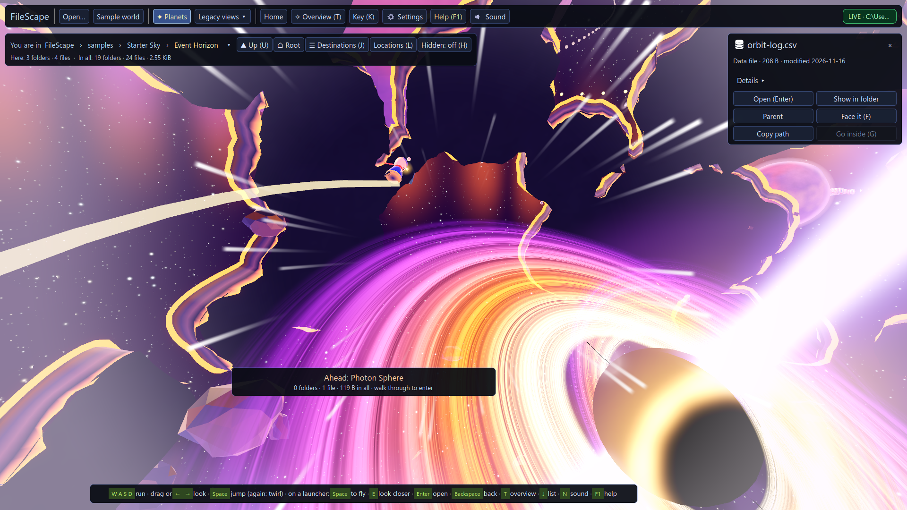

# FileScape

**What if you could walk into a folder?**

Land on a little planet, spot a folder hanging in the sky, and jump to it. Open a software project and climb onto a
workbench to see the README and where to start. Pull back into space and see how the places you’ve explored fit
together. Every kind of world has its own look, and the same melody might greet you as a quiet tune on one planet and
a drum-and-bass track on another.

FileScape is a playable file explorer for Windows, including your WSL folders. The idea is to make your computer feel
like a place you can get to know by exploring it. A file you need should be easy to reach, and a folder you’ve passed a
hundred times should still be able to surprise you.

*Garden Photos: a photo folder becomes a gallery beneath the stars. Interface hidden for photography.*

## Play in a few minutes

1. **Get the Windows x64 ZIP.** Download the [first public playtest](https://github.com/djenning90/filescape/releases/tag/v0.1.0-playtest).
2. **Extract the ZIP and run `FileScape.exe`.** The app opens in **This computer**, with your drives and WSL distributions.
3. **Choose Learn to play.** The guided walkthrough takes you to **Starter Sky**, a bundled sample world. You can replay it from **Help → Learn to play**.

Drag with the left mouse button to look around, move with **WASD**, and press **Space** to jump. Step onto a launch pad
and press **Space** again to fly to its folder. Press **T** to pull back into Overview, and **Esc** to return to the surface. Press **F1** for the full controls.

Looking for somewhere to go after the tutorial? Find **Event Horizon** in Starter Sky and see [what happens when you miss the edge](docs/media/planets-hazard-world.png).

Exploring in FileScape leaves your files in place. You can preview supported files in the game or deliberately open
them with Windows.

## A few places to discover

| A workshop beneath the auroras | A universe of folders |
| --- | --- |
|  |  |
| Every kind of place has its own atmosphere. | Move among the worlds to see how your folders connect. |

| Your project, close at hand | A little danger along the way |
| --- | --- |
|  |  |
| Read a README and find your project's entry points. | A missed landing brings you back to the parent folder. |

*November 25, 2026 captures of the public playtest's worlds. Scenic views use a separately positioned camera with the interface hidden; gameplay views retain it. Click an image to see it full size.*

## Help shape FileScape

**Play it and tell us what happened.** What made you want to explore? Where did you get lost? Which folder would you
love to see turned into a world? A few sentences about your first session are plenty. Share an idea or report a bug in
[Issues](https://github.com/djenning90/filescape/issues). For a bug, include the build ID and the steps that got you there. Starter Sky is a good place to capture a
screenshot you’re comfortable sharing.

**Make something with us.** Have an idea for a world, a musical variation, or a better way to get to your projects?
Read the [contributor guide](CONTRIBUTING.md), open an issue to sketch an idea, or send a focused pull request.
The [architecture guide](docs/architecture.md)
is a starting point for the code, and the [design decisions](docs/decisions.md) explain how the game fits together.

## Build from source

Open `app/project.godot` in **Godot 4.7.2 .NET** on Windows with the **.NET SDK** installed, then press **Play**.
The app, Core and tests target .NET 10. See the [Windows workflow](docs/windows-workflow.md) for builds,
tests, exports, and command-line launch options. The older flat worlds and maps are still available under
[Legacy views](docs/legacy-views.md).

## Credits and licences

FileScape was built by one human director and two AI agents.

- **David — Creator and director.** Conceived FileScape, defined what good looks and feels like, and steered its
  design through hands-on playtesting.
- **OpenAI Codex — Technical manager and design partner (GPT-6.1 Sol, Medium reasoning effort).** Explored design
  and architecture with David, wrote implementation prompts for Claude Code, and reviewed builds and evidence.
- **Anthropic Claude Code — Lead implementation agent (Opus 5.5, Medium effort, Ultra Code enabled).** Wrote
  the application, built its procedural worlds and synthesizer, tested features, and produced playable builds.

Built with the Godot Engine and .NET. The Windows package includes their licences and third-party notices. Planets
draws inspiration from *Super Mario Galaxy*, and Classic FSN from SGI’s *FSN* file-system navigator. FileScape’s worlds,
art, and synthesized music are original.

FileScape is licensed under the [MIT License](LICENSE). Copyright (c) 2026 David Jennings.
