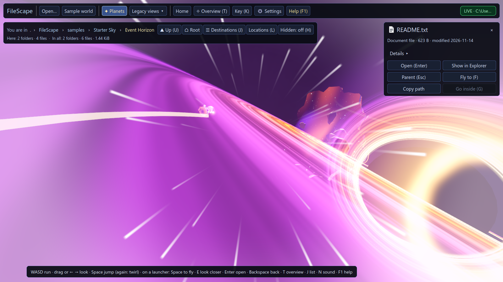

# FileScape

**Explore your files as little worlds you can run around.** Every folder is a small planet. Its subfolders hang in the
sky above flower launchers: stand on one, press Space, and you fly there, landing on the next world. Files stand in
groves you can walk up to and look at. Software projects have a workbench that shows where to start; This computer is
the hub where your drives and Linux distributions wait. Each kind of place has its own music and sky; system folders that are best left alone are Hazard Worlds
over a spinning black hole (step off an edge and you spiral down and back up to where you came from).




FileScape only reads names, sizes and dates. It never changes, moves or deletes your files, and it opens a file with
Windows only when you press Enter (or Open) yourself.

> **Status:** a first playtest build for Windows (x64). It is a prototype: expect rough edges. See
> [`docs/implementation-status.md`](docs/implementation-status.md) for what has been verified and what still needs judging by hand.

## Play

1. Download the Windows build (a zip from the project's releases), unzip it anywhere, and run **`FileScape.exe`**.
   The build is not code-signed yet, so Windows SmartScreen may ask you to confirm ("More info" → "Run anyway").
2. FileScape opens at **This computer**. The first time, it offers **Learn to play**: a few minutes of guided play in
   a bundled sample world (the *Starter Sky*). You can also start it any time from **Help → Learn to play**, or open
   the sample world from the toolbar's **Sample world** button.

The basics (the walkthrough teaches them):

| To… | Do this |
|---|---|
| Look around | drag with the left (or right) mouse button, or hold ← → |
| Run | W A S D (Shift: faster) |
| Jump / twirl higher | Space, and Space again in the air |
| Fly to a folder | stand on its flower launcher and press Space (or click its world and press G) |
| Look closer at a file | walk up to it and press E (Enter opens it with Windows) |
| Up a level / back | U goes to the parent; Backspace goes back to where you were |
| This world's list | J (type to filter, Enter to go) |
| Overview of every folder you know | T (drag to orbit, click a world, Enter to land; Esc to come back down) |
| Help | F1 |

Command-line options (for `FileScape.exe -- …`): `--root=hub` (This computer), `--root=sample` (the Starter Sky),
`--root=C:\some\folder` (start in a folder), `--vis=planets|places|classic|district` (start in a view).
`FileScape.console.exe` does the same from a terminal and waits for the window to close.

## Legacy views

FileScape began as a flat world of folders you walk through as doors (**Places**) and two whole-tree maps
(**Classic FSN**, an FSN-inspired landscape, and **District**, a futuristic city). They still work: open them from
the toolbar's **Legacy views** menu (or press V for Places and Tab for the maps). Their guide is in
[`docs/legacy-views.md`](docs/legacy-views.md).

## Build from source

FileScape is a [Godot](https://godotengine.org) 4.7 .NET (C#) app over an engine-independent C# core.

- **Windows** (the app targets Windows x64).
- **.NET SDK** 8 or later (the tests use .NET 10).
- **Godot 4.7.2 .NET** editor and its export templates (for building a standalone exe).
- **Optional: WSL** (Ubuntu). The repository's scripts (`tools/fs.sh`) run from WSL and call the Windows tools;
  set `FILESCAPE_GODOT_DIR` to the folder holding `Godot_v4.7.2-stable_mono_win64_console.exe` and, if needed,
  `FILESCAPE_DOTNET` to `dotnet.exe`.

From WSL:

```
tools/fs.sh build                         # compile the app and the core
tools/fs.sh test                          # the core's tests (Windows dotnet; tools/fs.sh test-wsl for Linux)
tools/fs.sh run                           # run from source (Planets at This computer)
tools/fs.sh run -- --root=sample          # the Starter Sky sample world
tools/fs.sh stage                         # export a standalone build into a fresh staging folder and smoke-test it
tools/fs.sh package staging-<stamp>       # a release zip with licences and notices
tools/fs.sh check smoke                   # quick end-to-end checks (full: the whole suite)
```

Without WSL: open `app/project.godot` in the Godot .NET editor and press Play, or run
`dotnet test tests/FileScape.Core.Tests` for the core's tests. More in
[`docs/windows-workflow.md`](docs/windows-workflow.md).

## How it is made

- `src/FileScape.Core`: the engine-free core (the folder tree and scanning, layouts, the planets' composition, the
  walkers, the procedural music). Tested by `tests/FileScape.Core.Tests`.
- `app/`: the Godot app (Planets, the legacy views, the HUD) and the journey probes that drive it in tests.
- Everything you see and hear is original and generated in code: the worlds, the icons, the sample files, and the
  music (synthesised from scratch, no samples). See [`docs/decisions.md`](docs/decisions.md) for why things are the
  way they are, and [`docs/code-documentation.md`](docs/code-documentation.md) for how the code explains itself.

## Credits and licences

FileScape is built with the Godot Engine (MIT licence) and .NET (MIT licence); a release zip carries their licences
and third-party notices in its `licenses` folder. Planets is a spiritual descendant of the joyful planet-hopping in
games such as *Super Mario Galaxy*, and Classic FSN is inspired by SGI's *FSN* file-system navigator; FileScape is not
affiliated with or endorsed by Nintendo or SGI, and uses none of their assets.

FileScape's own licence: **to be decided** (see the publication notes before publishing).
